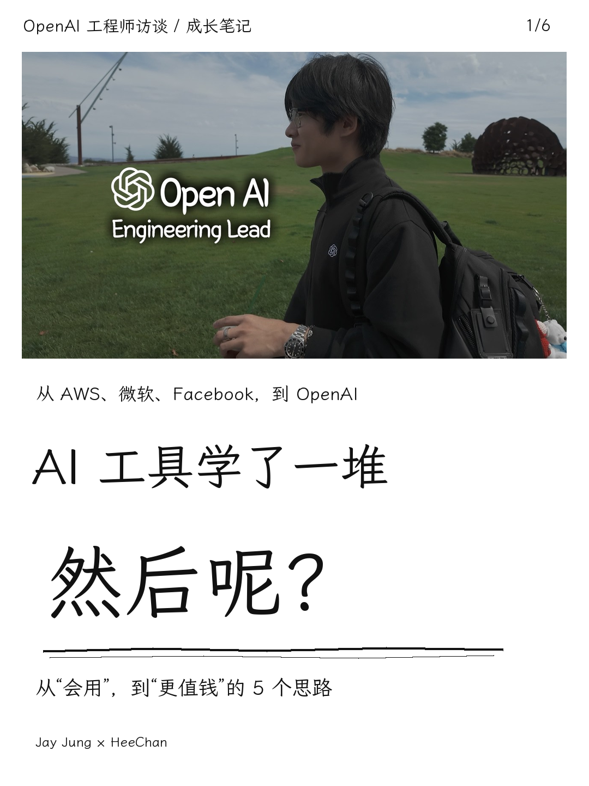
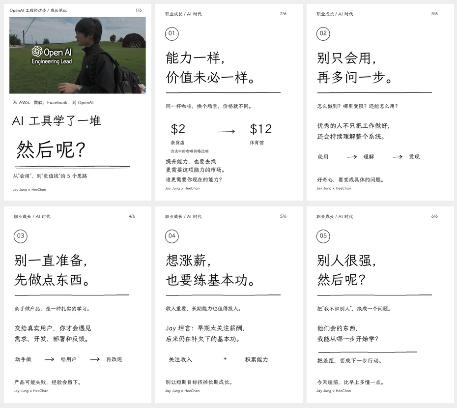

# xiaohongshunote

小红书白底黑字六图笔记 Skill。

把访谈、博客和学习素材整理成统一风格的小红书图文笔记：**白底黑字、成熟钢笔字感、真实素材封面、大留白**。默认输出一张封面和五张观点卡片，每张 1080×1440，同时生成发布文案和图片 ZIP。

模板包含可重复运行的 Python 排版脚本，以及供 Codex 使用的内容整理、标题推荐和草稿审核说明。

维护者：**一以万真** · [完整案例](examples/openai-career/README.md) · [展示页](showcase.html) · [第三方素材说明](THIRD_PARTY_NOTICES.md)

下载后用浏览器打开 `showcase.html`，即可查看完整六图展示。

内置完整字体采用 XZ 无损压缩，脚本自动加载；保留全部字形，不需要手动解压。包中保留完整六图案例，省去重复参考单图。





案例与来源说明见 [examples/openai-career](examples/openai-career/README.md)。

## 快速运行

支持 Windows、macOS 和 Linux，需要 **Python 3.9+** 与 **Pillow>=9.1,<13**。在仓库根目录执行：

```sh
python -m pip install -r requirements.txt
python skills/artifact-template-xiaohongshu/scripts/render_cards.py --spec skills/artifact-template-xiaohongshu/references/example-content.json --out output/demo
```

Windows PowerShell 也可直接运行以上命令；如果系统只提供 `python3`，将命令中的 `python` 替换为 `python3`。

输出目录必须为空。生成 `01.png`–`06.png`、`preview.jpg`、`images.zip` 和 `post.txt`。制作新主题时，复制示例 JSON，替换全部文字、来源人物和原封面图片，再把 `--spec` 指向新文件。字段说明见 [输入与版式](skills/artifact-template-xiaohongshu/references/layout-and-input.md)。

## 安装到 Codex

将 `skills/artifact-template-xiaohongshu` 目录复制到 `~/.codex/skills`。以下命令同样在仓库根目录运行；若已安装同名技能，请先检查旧版本，避免无意覆盖。

Windows PowerShell：

```powershell
New-Item -ItemType Directory -Force -Path "$HOME/.codex/skills" | Out-Null
Copy-Item -LiteralPath "skills/artifact-template-xiaohongshu" -Destination "$HOME/.codex/skills" -Recurse
```

macOS / Linux：

```sh
mkdir -p ~/.codex/skills
cp -R skills/artifact-template-xiaohongshu ~/.codex/skills/
```

在 Codex 中调用：

```text
$artifact-template-xiaohongshu
把我提供的访谈文稿制作成六张小红书图片，使用附件中的原视频封面。
直接给一个最佳标题，并生成带空格分隔标签的发布文案。
只交付图片和文案，不发布。
```

## 工作边界

**排版脚本不需要模型 API。** 它读取已写好的 JSON 和图片，用真实字体绘制文字。素材摘要、观点提炼和标题创作由使用技能的 agent／模型完成，相关服务费用取决于所用平台。

脚本不抓取视频字幕、不下载视频、不登录平台，也不上传或发布笔记。技能中的浏览器草稿流程是可选操作，需要可用的浏览器工具和用户明确要求；默认只上传、填入内容并留给用户审核，发布由用户本人点击。

封面使用当前材料的真实画面，不把示例人物套用到新主题。请提供适合使用的原封面和材料；示例内容仅用于演示。

## 许可

- 代码与原创技能说明采用 [MIT License](LICENSE)。
- 内置霞鹜文楷字体采用 SIL Open Font License 1.1，见 [字体许可证](FONT-LICENSE.txt)。
- 示例中的原视频封面画面属于原权利人，**不在本项目 MIT 授权范围内**。案例不授予对人物、标识或第三方素材的额外权利。复用或公开传播案例画面前，请自行确认适用授权。

